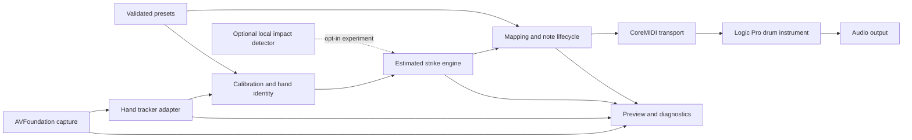

# Architecture and implemented Milestone 1 boundaries

Status: owner approved the proposed Milestone 1 direction on 2026-10-27. Capture,
Vision adapter, preview and numerical/resource diagnostics are implemented in
source. Successful native build and hardware behavior are **unverified**. All strike/MIDI/
plugin paths below remain future designs. See [DECISIONS.md](DECISIONS.md).

## Actual source layout

| Files | Implemented responsibility |
| --- | --- |
| `Package.swift` | macOS 14+, Swift tools 5.9/Swift 5 mode; dependency-free Core library/tests; native executable target included only on macOS |
| `Sources/TapDrumCore/HandObservation.swift` | Validated 21-joint observations, anatomical labels, confidence filtering, five-anchor palm proxy and coordinate-origin conversion |
| `Sources/TapDrumCore/Diagnostics.swift` | Timestamp/freshness rules, fixed-capacity numerical statistics, analyzed cadence and process CPU deltas |
| `Sources/TapDrumCore/PreviewProjection.swift` | Explicit lower-left Vision→overlay image-rectangle projection and inverse clicks, including mirroring/letterbox offsets; fixes the reflected overlay in the reviewed trial |
| `Sources/TapDrumCore/PlayingArea.swift` | Convex quadrilateral validation, bidirectional homography to local unit-square positions and bounded four-click/reset state; no height/contact inference |
| `Sources/TapDrumApp/CapturePipeline.swift` | Device/format discovery, camera-only session setup, synchronous bounded-inflight analysis with late-frame discard, per-run delegates and interruption/error recovery |
| `Sources/TapDrumApp/VisionHandTracker.swift` | Replaceable tracker protocol, two-hand VN request, explicit finger mapping and frame-scoped chirality; no persistent track IDs |
| `Sources/TapDrumApp/CameraModel.swift` | Main-actor controls, permission/run tokens, stale-overlay policy and periodic resource updates |
| `Sources/TapDrumApp/CameraPreview.swift` | Native preview layer with image-rectangle lookup, confidence-gated skeleton/optional finger labels/palm ring, explicit lower-left projection and preview-only mirroring |
| `Sources/TapDrumApp/ResourceSampler.swift` | Darwin process CPU and physical footprint plus thermal state; no native measurements run here |
| `Sources/TapDrumApp/ContentView.swift`, `TapDrumApp.swift` | Controls, diagnostics, app lifecycle and orderly asynchronous stop on quit |
| `Resources/Info.plist`, `scripts/` | Camera-only local `.app` packaging/ad-hoc signature and build/run entry points; native execution pending |

The capture queue runs both session mutation and per-frame inference. The output
drops late frames while inference blocks that queue; there is no custom pending
frame list. Numerical/overlay updates are throttled to 10 Hz. A per-run delegate
token rejects old callbacks after restart, and UI permission/snapshot tokens reject
old completions. Retained numeric histories cap at 240 values; frames and raw
landmark histories are not written to disk. The current observation is transient.

Freshness uses a 250 ms threshold evaluated on incoming UI snapshots and a 250 ms
timer, so a silent camera's overlay may take roughly 500 ms to clear when the main
thread is responsive. This is a display policy, not a real-time latency guarantee.
Camera switching is explicit Stop→select→Start. Only landscape with zero output
rotation is supported initially; rotate/reposition only between runs. Automatic
cross-frame identity association, physical contact calibration and musical output
are absent. Guided image-area calibration is implemented as described below.

## Guided image-area foundation

The current branch adds a four-click convex playing region in normalized,
unmirrored Vision coordinates. The preview's inverse projection maps clicks into
that domain, rejecting black bars. Core validates corner count/order, convexity,
area and invertibility, then builds a projective transform and inverse. A unit
square is a local on-plane coordinate convention, not metric table geometry or
finger height. Projected fingertip membership is diagnostic only, including hover.

State is session-only: begin/collect four corners/ready/reset. Device/mode changes,
stop/start, interruption and stale frames invalidate it. Mirroring and resize keep
the underlying image geometry. Live camera movement is not automatically detected;
the UI requires manual reset after movement/framing changes. No raw trajectories
or images are saved. Nine new Core tests cover geometry and selection states.
This first M2 foundation is within the owner's correction/calibration request;
it does not assert M1 acceptance, strike recognition or MIDI readiness.

The existing 10 Hz publisher is for display only. A future strike engine must
consume every accepted tracker result and source/host timestamps on the processing
path before publication; using SwiftUI's throttled snapshots would sacrifice
temporal resolution. No inference throttling is added by calibration.

The first Mac build exposed an unsupported preset reference: `.inputPriority`
is not a macOS API. Capture now sets device `activeFormat` and min/max frame
durations inside `beginConfiguration`/`commitConfiguration`, without setting
that preset. See [Apple's activeFormat documentation](https://developer.apple.com/documentation/avfoundation/avcapturedevice/activeformat)
and the owner-supplied SDK diagnostic in `TEST_RESULTS.md`. A native rebuild is
pending. Stop completions explicitly carry `@MainActor @Sendable` and are
dispatched to the main queue by the pipeline after stop and state publication.

Native behavior, coordinate alignment, Vision API type-checking, privacy prompts,
resource calls and local signing need the owner's Mac; Linux Core tests cannot
establish these. See [BUILD_AND_RUN.md](BUILD_AND_RUN.md).

## Recommended first experiment

Use a standalone native macOS app, provisionally Swift/SwiftUI, AVFoundation,
Apple Vision, and CoreMIDI. It has no audio engine initially; Logic supplies drum
sounds after independent MIDI validation. This minimizes integration work before
the contact hypothesis is tested. It does not establish Vision's speed/accuracy.

Keep a tracker adapter so MediaPipe can be evaluated on the same labeled cases
if Vision cannot meet the measured requirements. Do not implement both backends
up front. Do not assume MediaPipe's iOS package works in a native macOS target.
Compare alternatives in [TECH_STACK.md](TECH_STACK.md).

The owner reports Logic Pro 10.7.2 and Xcode 26.6 on macOS 26.5.2. Apple's Xcode
table supports that host-range pairing on paper, but the older Logic version's
behavior on this OS needs a live check. Do not mandate an upgrade based only on
age. The reported iPhone 17 Pro/iOS 26.6.2 exceeds the documented Continuity
baseline; real capture/format/account setup remains untested. See the inventory.

## Boundaries and conceptual contracts

These are design contracts, not declarations of existing source modules.

| Boundary | Output and responsibilities |
| --- | --- |
| Capture | Frame identifier, device/format identity, pixel buffer, source timestamp/timebase, host arrival time, orientation and dropped-frame counters |
| Tracker | Frame-linked hand observations: normalized landmarks, available confidence, anatomical handedness or unknown, optional model depth; no MIDI calls |
| Identity/calibration | Session track IDs, orientation transform, table region/homography and validity, per-contact rest/release references; uncertainty retained |
| Strike engine | Unique event ID, hand/contact, estimated event time, recognition/emission time, confidence/features and calibration version; no claim of confirmed contact |
| Mapping/lifecycle | Validated channel/note/velocity, event ownership, scheduled Note Off, collision policy and route generation |
| MIDI transport | One selected virtual source or destination route, timestamp conversion, error/connection reporting; no camera access |
| Presets | Versioned non-sensitive configuration, validation and migration; calibration bound to device/format/orientation/session validity |
| Diagnostics/UI | Main-thread UI updates; bounded numerical counters and timing summaries, no default video/audio logs |
| Future audio unit | Audio/MIDI processing and sample/kit state only; no camera permissions, capture or inference in the host/render callback |

Do not fabricate per-joint confidence when a backend supplies only other scores.
Backend-specific confidence must remain identifiable. Palm base is a derived
proxy, not a directly observed pressure/contact point.

## Scheduling and resource policy

Capture session configuration uses a dedicated serial queue; frame analysis uses
a bounded worker path. Prefer the newest frame with at most one waiting frame
rather than allowing latency to grow through an unbounded queue. Count dropped
frames, since dropping can also miss strikes. Preview is decoupled and may update
more slowly. Preserve pixel-buffer ownership until analysis finishes; avoid
unnecessary full-frame conversions/copies and allocations in the hot path.
Apple documents `alwaysDiscardsLateVideoFrames` for late-frame rejection and
warns against defaulting to BGRA conversion because of extra work/memory. Select
a native format the tracker accepts and measure any necessary conversion. Apple's
Continuity sample includes microphone capture; do not run/copy that sample
unchanged into this camera-only experiment. Check current discovery APIs in the
installed SDK; its older sample uses a legacy external-device discovery path.

Use a monotonic host clock for durations. Preserve source capture timestamps and
verify their relationship to host time instead of assuming they are exposure
times. Convert to CoreMIDI host timestamps explicitly. Reject out-of-order or
stale observations. Report capture arrival, inference duration, evidence delay,
and emission separately. Backdating MIDI timestamps or estimated contact times
cannot undo monitoring delay already incurred.
Apple defines `MIDITimeStamp` in `mach_absolute_time()` host-clock units; timebase
conversion must be explicit rather than passing nanoseconds or wall-clock dates.

On tracking loss, freeze/reject uncertain contacts and require credible release
before rearming. A hand reacquired at a new location is not a strike. Camera or
format changes invalidate calibration and pause output. Stable background table
features may help detect camera movement; inability to verify validity must be
visible. A monocular camera cannot guarantee all movement will be detected.

## Strike hypothesis

Begin with interpretable per-contact states: unavailable → released/armed →
approaching → candidate impact → triggered → release/refractory. Transitions
need confidence, calibrated image-space approach direction, temporal motion,
reversal evidence, and a credible release before the next hit. Image-space
“down” is not necessarily motion toward the table. Use timestamp-based durations,
not fixed frame counts; record the extra frame delay needed for confirmation.

Evaluate temporal landmarks alone first, then selective optical flow. The current
owner choice is camera-only with no recordings; microphone work is excluded.
Only with separate future permission could microphone confirmation be compared.
A global microphone
transient may confirm an impact time but cannot by itself identify a finger or
separate simultaneous contacts. Acoustic background and loudspeaker drum playback
can cause feedback triggers; test these explicitly. Never delay all hits waiting
for sound without reporting the resulting latency trade-off.

## MIDI lifecycle and Logic routing

Propose channel 10 with the product's defaults. Internally channels are human
1–16 and encoded as 0–15 only at the MIDI boundary. Notes are 0–127, emitted
Note On velocity is 1–127; zero-velocity Note On means Note Off. Velocity is a
bounded per-contact motion estimate, with no force claim.

MIDI 1.0 cannot independently address overlapping voices with the same channel
and note. Proposed policy: coalesce same-batch duplicate pitches at maximum
velocity, log all source contacts, and for later retriggers close the previous
note before reopening it, invalidating its pending Note Off. Confirm this with
an independent receiver and Logic before adopting it. Other pitches remain
independent. Note duration is configurable; do not choose an untested fixed
duration as a universal solution.

On route changes, stop, or orderly exit, send explicit Note Off for owned notes,
cancel stale schedules, and use appropriate channel cleanup. A crash cannot
guarantee cleanup messages; document receiver behavior and provide a visible
panic/reset action. Do not send cleanup to unrelated routes/channels casually.

First test a CoreMIDI virtual source; an existing IAC route can be a diagnostic
fallback. Use only one path to Logic at a time to prevent duplicate events.
Apple documents `MIDISourceCreateWithProtocol` plus `MIDIReceivedEventList` to
publish from an app-owned source. Sending to an existing destination instead uses
`MIDISendEventList`; these directions must not be confused. Keep MIDI 1.0 note
semantics initially, with the appropriate protocol/event encoding and tests.
Verify the actual Logic input filter/routing, instrument map, MIDI recording,
playback and bounce. A working endpoint or moving MIDI meter is insufficient.
The current Logic guide documents “Logic Pro Virtual In,” but does not establish
that route exists in the owner's **10.7.2**. Prefer the app-owned source for the
first experiment and verify the actual version's input controls; menu names in
newer documentation must not be presented as tested instructions for 10.7.2.

## Future plugin boundary

Only after Milestone 4: compare AUv2 music device and AUv3 instrument targets on
the confirmed Logic/macOS versions. Camera permissions, extension lifecycle,
sandboxing, interprocess communication and signing are separate risks. Default
to normal MIDI between companion and host rather than undocumented host process
control. The plugin's audio thread must only perform bounded rendering/event
work; loading samples/state and any IPC handoff occur off that thread. No custom
sampler or plugin implementation is authorized in Milestone 0.
